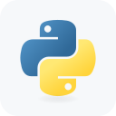
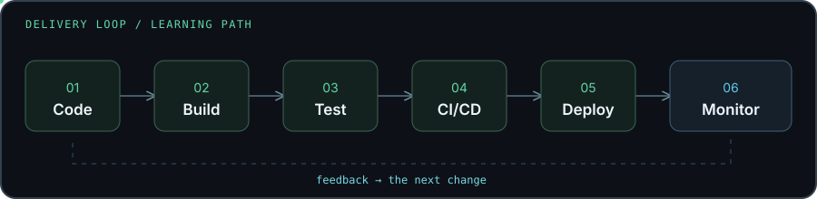

 

  

 

 

## About me

I'm exploring what happens beyond application code: how Linux services run, how systems talk to each other, and how deployments become repeatable.

My hands-on work includes a **seven-VM Linux infrastructure lab**, **Java and Spring Boot** backends, **GitHub Actions** CI, **Azure** deployment demos, and **Python** automation. I also share what I learn as a Microsoft Learn Student Ambassador and Postman Student Expert.

 

## Toolbox

<table>
  <tr>
    <td align="center" width="140"><b>Linux & systems</b></td>
    <td>
      &nbsp;&nbsp;
      &nbsp;&nbsp;
      &nbsp;&nbsp;
      
       Linux · Ubuntu · CentOS Stream · Nginx · Tomcat
    </td>
  </tr>
  <tr>
    <td align="center"><b>Cloud & infra</b></td>
    <td>
      &nbsp;&nbsp;
      
       Microsoft Azure · Azure Static Web Apps · Vagrant
    </td>
  </tr>
  <tr>
    <td align="center"><b>CI/CD & automation</b></td>
    <td>
      &nbsp;&nbsp;
      &nbsp;&nbsp;
      
       Git · GitHub · GitHub Actions · Bash
    </td>
  </tr>
  <tr>
    <td align="center"><b>Backend</b></td>
    <td>
      &nbsp;&nbsp;
      &nbsp;&nbsp;
      &nbsp;&nbsp;
      
       Java · Spring Boot · Maven · Python
    </td>
  </tr>
</table>

Everything above has been used in projects, coursework, or local labs.

  

**Learning next** — roadmap technologies, not claims of project experience

 

## Projects

<table>
  <tr>
    <td width="50%" valign="top">
      <h3><a href="https://github.com/kavinduumayanga/devops-multi-tier-deployment">Multi-tier Linux deployment lab</a></h3>
      <b>Primary DevOps project</b> · 7 Linux VMs · manually configured
      
Nginx balances traffic across two Tomcat servers backed by shared MySQL, Memcached, and NFS. Includes RabbitMQ monitoring, a Java infrastructure dashboard, and documented failover tests.

      
      
      
      
      
    </td>
    <td width="50%" valign="top">
      <h3><a href="https://github.com/kavinduumayanga/ridelink-backend">RideLink backend</a></h3>
      4-service Spring Boot university project
      
JWT security and GitHub Actions CI. I own <b>Ride Management</b>: ride lifecycle, driver assignment, and Driver/Fare service integration.

      
      
      
      
    </td>
  </tr>
  <tr>
    <td width="50%" valign="top">
      <h3><a href="https://github.com/kavinduumayanga/certloop">CertLoop</a></h3>
      Local-first automation tool
      
Turns CSV participant data into personalized PDF certificates, with operator-confirmed email delivery and delivery tracking.

      
      
      
    </td>
    <td width="50%" valign="top">
      <h3><a href="https://github.com/kavinduumayanga/azure-staticweb-demo">Azure Static Web Apps demo</a></h3>
      Built for a Microsoft Learn Student Ambassadors session
      
A responsive portfolio deployed through Azure Static Web Apps and GitHub Actions.

      
      
      
    </td>
  </tr>
</table>

 

## The loop I'm learning

 

## Activity

  

Contribution snake refreshed every 12 hours by <a href="https://github.com/kavinduumayanga/kavinduumayanga/actions/workflows/snake.yml">GitHub Actions</a>.

 

**Open to conversations about Linux, backend engineering, and the DevOps journey.**

