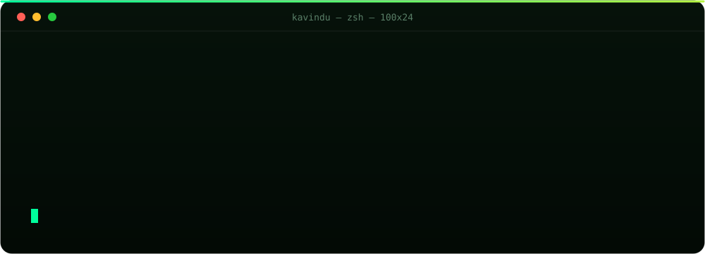
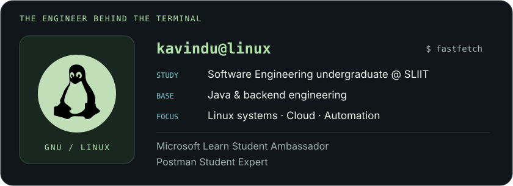
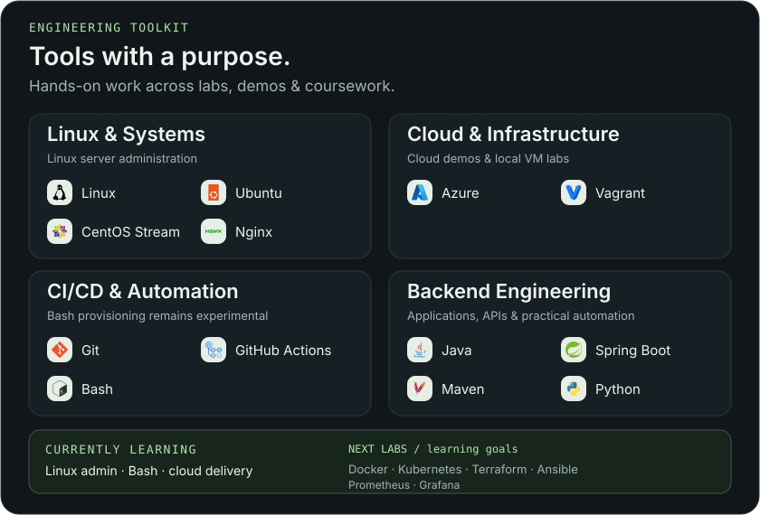
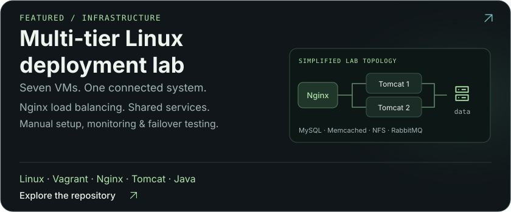
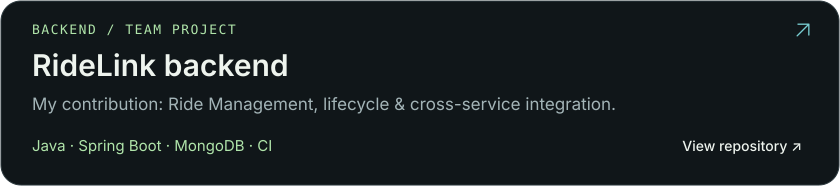
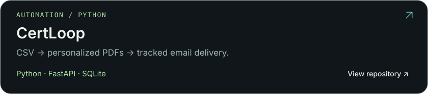
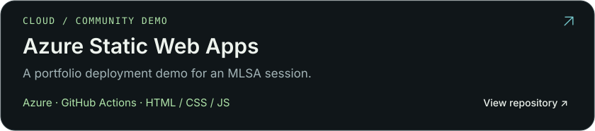

<!-- Artwork is generated by scripts/build_profile_assets.py. All icons are embedded locally. -->

<picture>
  <source media="(max-width: 900px)" srcset="assets/terminal-mobile.svg">
  
</picture>

<picture>
  <source media="(max-width: 900px)" srcset="assets/about-mobile.svg">
  
</picture>

<picture>
  <source media="(max-width: 900px)" srcset="assets/toolkit-mobile.svg">
  
</picture>

## Selected work

<a href="https://github.com/kavinduumayanga/devops-multi-tier-deployment">
  <picture>
    <source media="(max-width: 900px)" srcset="assets/projects/linux-lab-mobile.svg">
    
  </picture>
</a>

<a href="https://github.com/kavinduumayanga/ridelink-backend">
  <picture>
    <source media="(max-width: 900px)" srcset="assets/projects/ridelink-mobile.svg">
    
  </picture>
</a>

<a href="https://github.com/kavinduumayanga/certloop">
  <picture>
    <source media="(max-width: 900px)" srcset="assets/projects/certloop-mobile.svg">
    
  </picture>
</a>

<a href="https://github.com/kavinduumayanga/azure-staticweb-demo">
  <picture>
    <source media="(max-width: 900px)" srcset="assets/projects/azure-mobile.svg">
    
  </picture>
</a>

<picture>
  <source media="(max-width: 900px)" srcset="assets/devops-workflow-mobile.svg">
  
</picture>

<strong>Contribution trail</strong> · a snapshot of the work along the way

 

<picture>
  <source media="(prefers-color-scheme: dark)" srcset="https://raw.githubusercontent.com/kavinduumayanga/kavinduumayanga/output/github-contribution-grid-snake-dark.svg">
  
</picture>

[Contribution history](https://github.com/kavinduumayanga?tab=overview) · [Generated every 12 hours](https://github.com/kavinduumayanga/kavinduumayanga/actions/workflows/snake.yml)

  <strong>Learn the system. Automate the repeatable.</strong> 
  <a href="https://www.linkedin.com/in/kavindu-umayanga-93239b319">LinkedIn</a> &nbsp; · &nbsp;
  <a href="https://github.com/kavinduumayanga">GitHub</a> &nbsp; · &nbsp;
  <a href="https://www.hackerrank.com/kavinduumayanga">HackerRank</a> &nbsp; · &nbsp;
  <a href="mailto:kavinduumayanga@gmail.com">Email</a>

